# TAXBROS LMS: Administrator manual

This manual is for institute administrators. Administrators can do everything in the system: manage
people and classes, author courses and quizzes, run the practice labs, mark attendance and read reports.

## 1. Signing in

1. Open the TAXBROS LMS address in Chrome or Edge (or the Android app).
2. Enter your email and password and choose **Sign in**.
3. If your account is new, or your password was reset, you are asked to set your own password first.
   It needs at least 8 characters with an uppercase letter, a number and a special character.

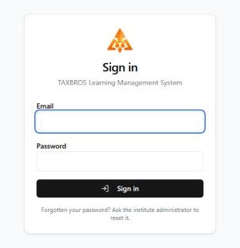

After 5 wrong passwords in a row the account is locked for 15 minutes.

To change your password at any time, choose the key icon (**Change password**) in the top bar. Every
other device you are signed in on is signed out.

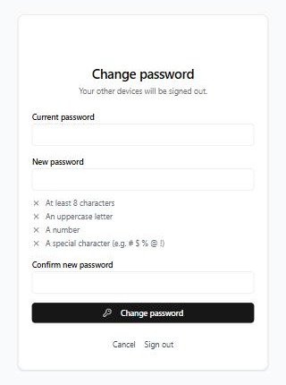

## 2. Dashboard

The dashboard shows how many people use the system, today's student and staff attendance, and the most
recent class registers. "Today" is worked out in the institute timezone (see Settings).

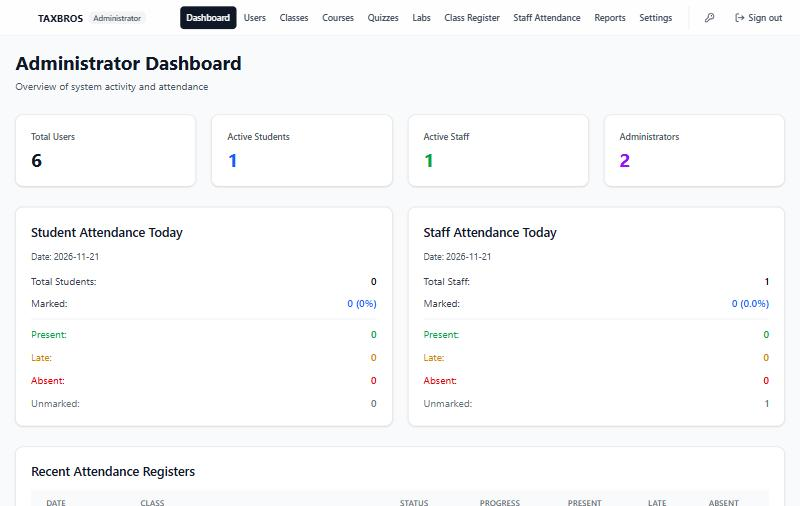

## 3. Users

**Users** lists every account. Search by name or email, and filter by role and status. Choose
**Students** or **Staff** in the role filter to get extra filters:

- Students: admission ID, class, admitted from / to.
- Staff: staff ID, department, designation, category.

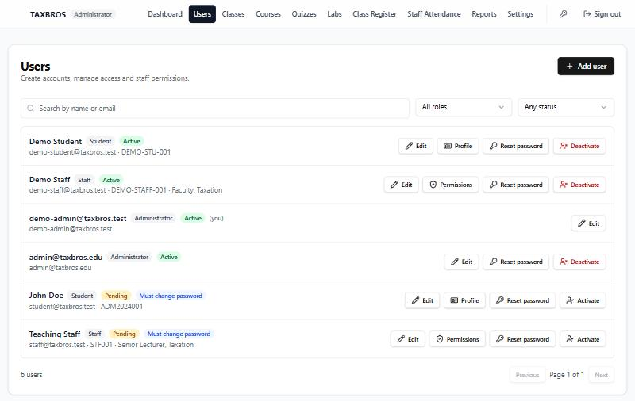

### Create an account

1. Choose **Add user**.
2. Pick the role (Student, Staff, or Administrator for super admins).
3. Fill in email, name and the role details (admission ID and admission date for students; staff ID,
   designation, department, category and joining date for staff).
4. A temporary password is generated for you. Choose **Create user**.
5. The temporary password is shown **once**. Copy it and give it to the person; they must change it when
   they first sign in.

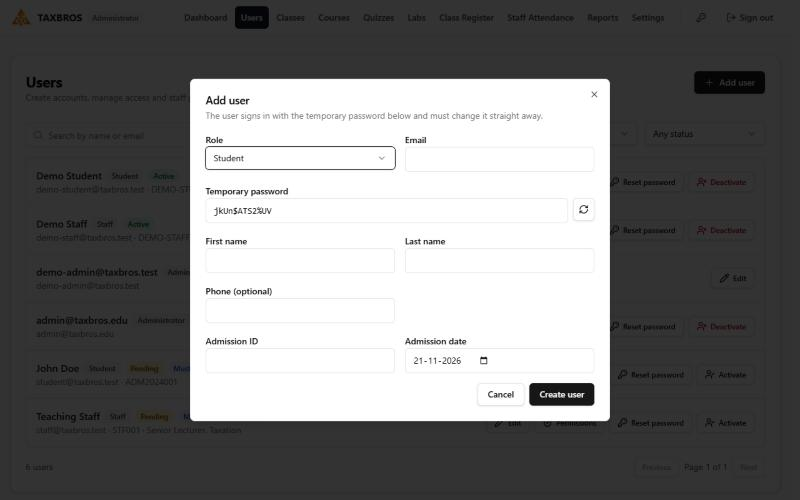

### Other actions on an account

| Action | What happens |
|---|---|
| **Edit** | Change name, email and profile details. Email, admission ID and staff ID must stay unique. |
| **Profile** (students) | Opens the student profile: course progress, classes and every quiz attempt with answers. |
| **Permissions** (staff) | Choose what the staff member may do (next section). |
| **Reset password** | Signs the person out everywhere and shows a new temporary password once. |
| **Deactivate** | Signs the person out everywhere and stops them signing in. Their records are kept. |
| **Activate** | Lets a deactivated or pending account sign in again. |

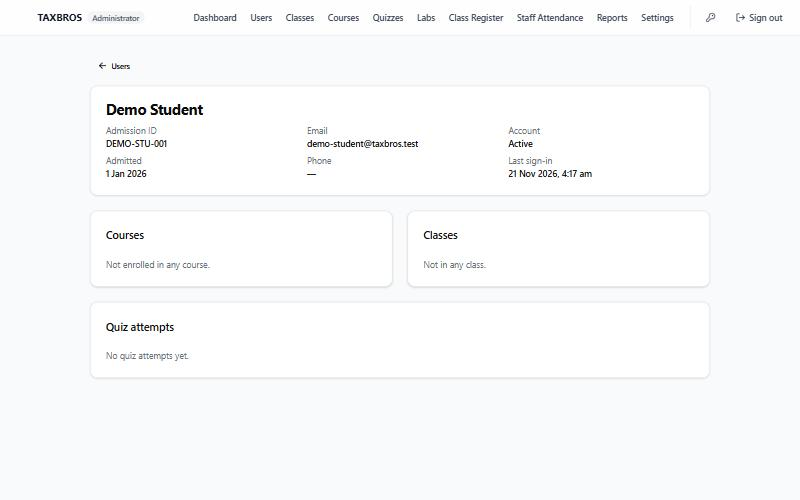

### Staff permissions

Staff only see the screens their permissions allow. Changes take effect immediately.

| Permission | Lets staff |
|---|---|
| Mark attendance | Open and mark class registers |
| View reports | See monthly attendance reports |
| Manage students | Create and edit student accounts, reset their passwords, view student profiles |
| Manage staff | Create and edit staff accounts that have no more permissions than their own |
| Manage classes | Create, rename and archive classes; add and remove students |
| Manage courses | Courses, modules, lessons, quizzes and course enrolments |
| Manage labs | Lab sample data and turning labs on or off |

Staff can never grant permissions, change their own account from the Users screen, or manage
administrators.

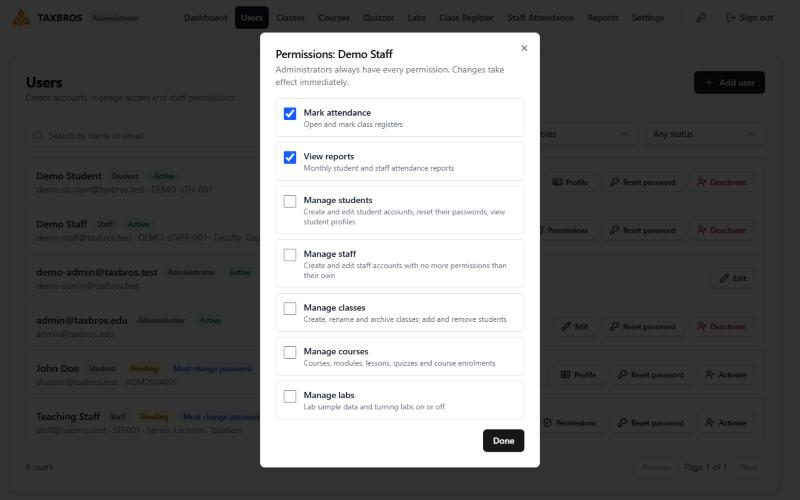

## 4. Classes

Classes group students for attendance.

1. **New class**: give it a unique name.
2. **Students**: search for active students and add them; remove a student with the remove button.
   Removing keeps their past attendance.
3. **Rename** or **Archive** a class. Archived classes move to the **Archived** tab and can be restored.

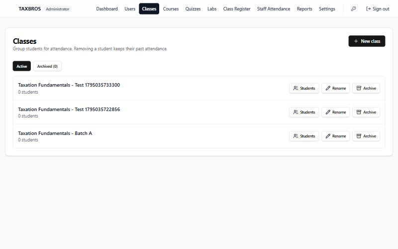

## 5. Courses

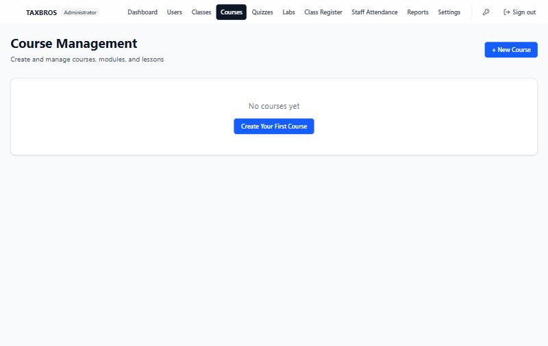

### Create a course

1. Choose **New Course**, enter a title and description, then **Create course**. Courses start as drafts.
2. In the **Course Editor**, add a cover image if you like.
3. **Add Module** for each section of the course.
4. In each module, **Add Lesson**: title, description, the YouTube address (use **unlisted** videos) and
   the duration in seconds (for example 600 for 10 minutes).
5. Publish the lessons, then publish the course. Students only see published courses and lessons.

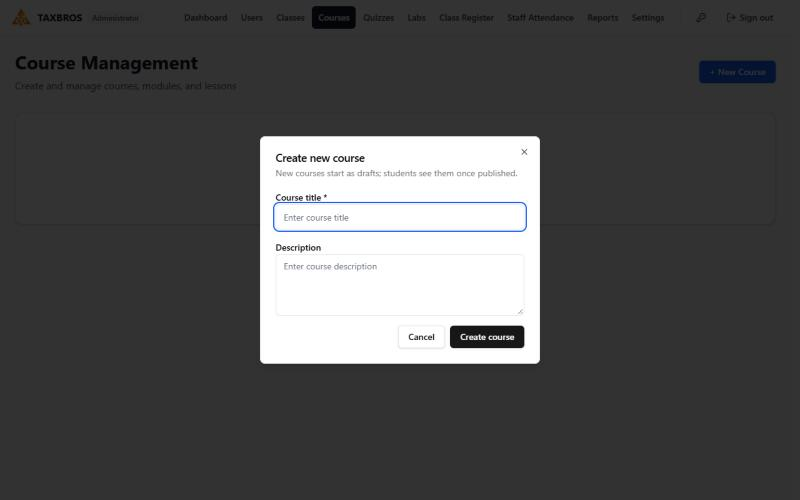

### Enrol students

On the course page, under **Enrolled students**, search for a student and choose **Add**. The course must
be published first. Removing a student keeps their progress; adding them again restores it.

## 6. Quizzes

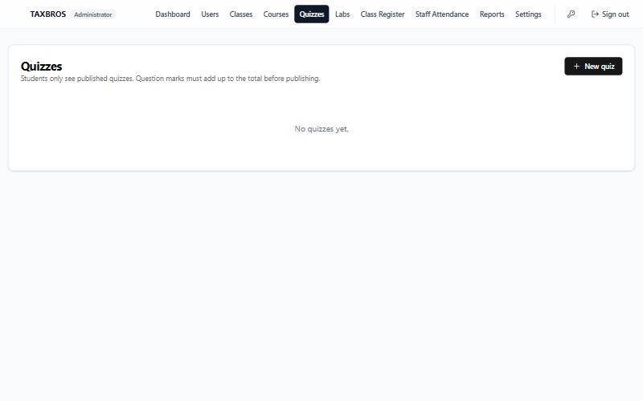

1. **New quiz**: title, what it belongs to (course, module or lesson), total marks, pass mark, and
   optionally a time limit (minutes) and a maximum number of attempts.
2. Add questions: question text, 2 to 6 options, the correct option and the marks.
3. **Publish** when the question marks add up exactly to the total marks. Students only see published
   quizzes and never see the answers before submitting.
4. To change a published quiz, move it back to draft first.

A student's attempts, with their answers, are on their **Profile** (Users screen).

## 7. Practice labs

The GST registration, ITR filing and MCA incorporation labs are training simulations with fictional data.
They are never connected to government portals.

- **Visible to students** turns a lab on or off.
- **Edit Sample Data** changes the fictional data students start with. Only use made-up names, PANs and
  addresses.
- **Preview** shows the lab as students see it.

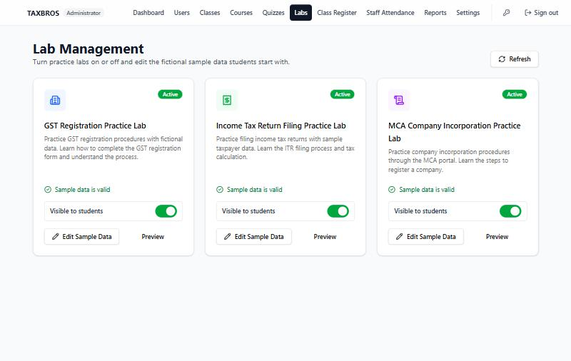

## 8. Attendance

### Class register

1. Open **Class Register**, choose the class and the date (today by default, in the institute timezone).
2. Mark each student **Present**, **Absent** or **Late**, add remarks if needed, and **Save**.
3. A saved register can be opened again and corrected. Future dates can't be marked.

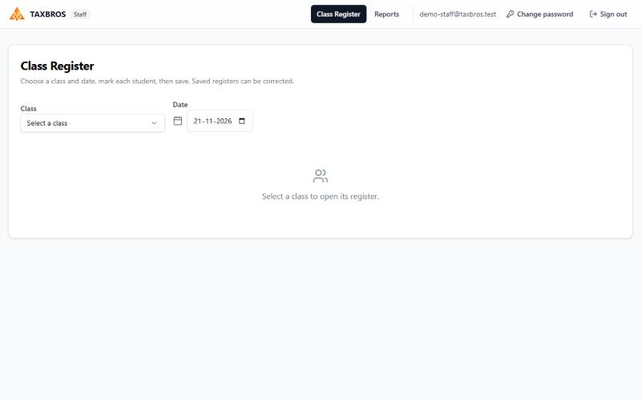

### Staff attendance

**Staff Attendance** lists active staff for the chosen date. Mark each one, or use **Mark rest Present**,
then **Save Attendance**.

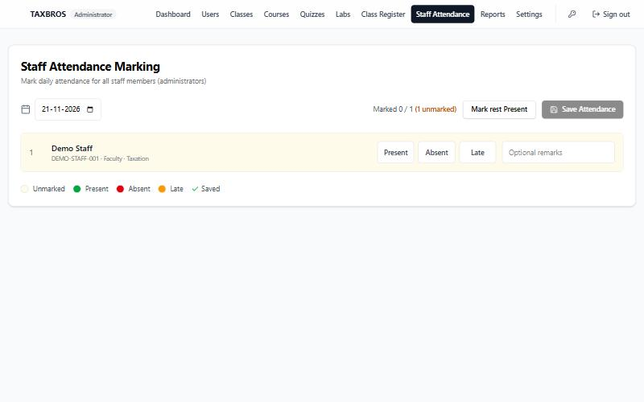

## 9. Reports

**Reports** shows monthly attendance per student: present, late, absent, unmarked days and the attendance
percentage. Filter by year, month and class, and use **Export to CSV** for a spreadsheet.

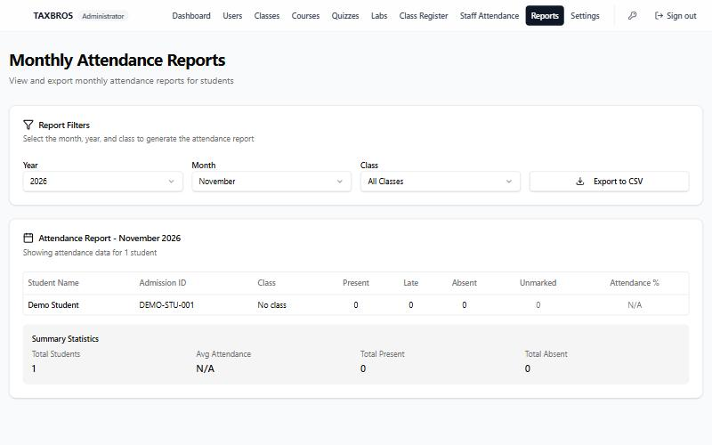

## 10. Settings

**Settings** holds the institute timezone (Asia/Kolkata by default) and the institute name. Attendance
dates and displayed times use the timezone. Each setting shows who last changed it and when.

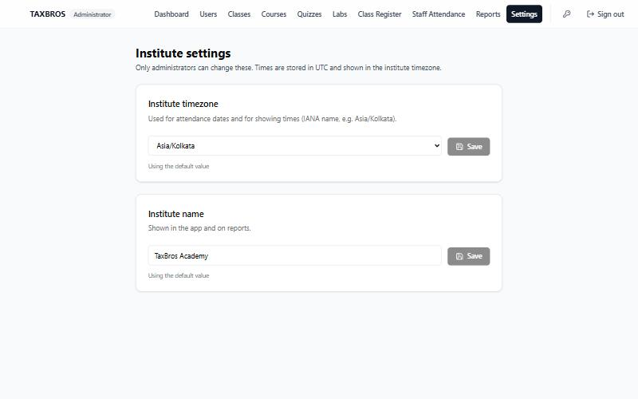

## 11. Good practice

- Give each person their own account; never share passwords.
- Deactivate accounts of people who leave instead of deleting anything.
- Grant staff only the permissions they need.
- Use only fictional data in the labs.
