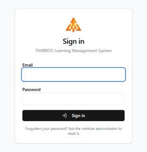
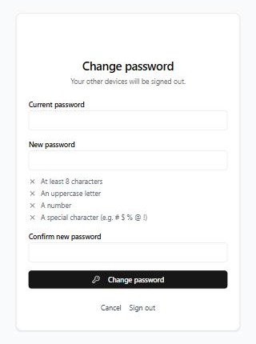
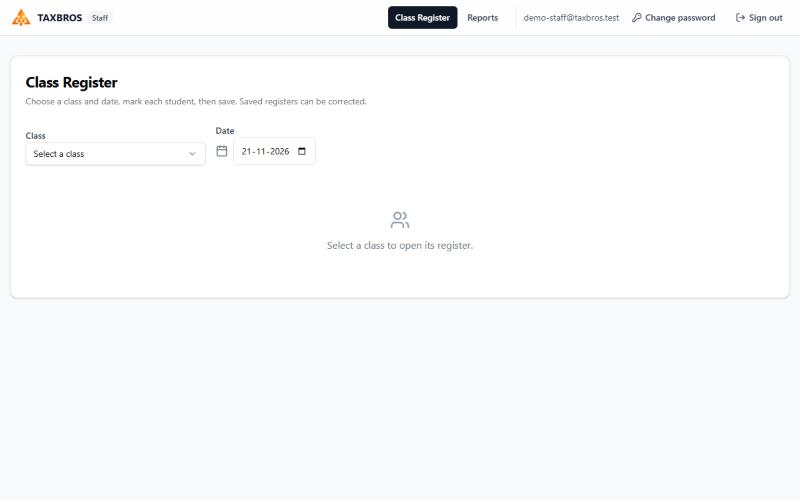
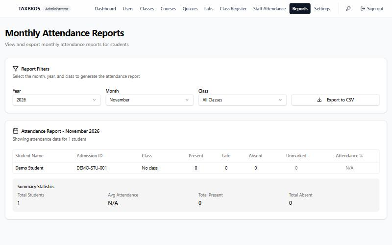
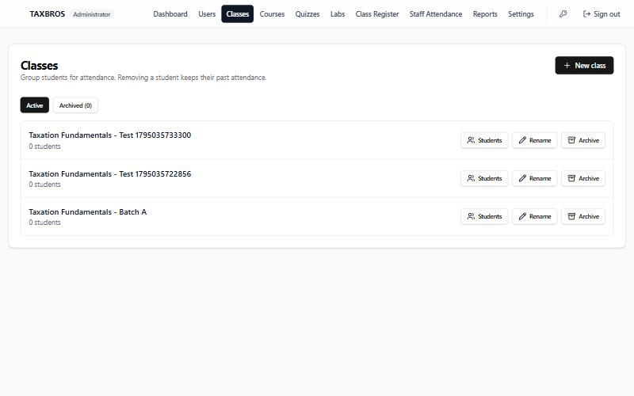

# TAXBROS LMS: Staff manual

This manual is for teaching and office staff. What you can do depends on the permissions your
administrator has given you. Your menu only shows the screens you are allowed to use.

## 1. Signing in

1. Open the TAXBROS LMS address in Chrome or Edge (or the Android app).
2. Enter the email and temporary password your administrator gave you and choose **Sign in**.
3. Set your own password straight away: at least 8 characters with an uppercase letter, a number and a
   special character.

To change your password later, choose **Change password** in the top bar. Forgotten your password? Ask
an administrator to reset it.

## 2. Your menu and permissions

| Permission | Menu item | What you can do |
|---|---|---|
| Mark attendance | Class Register | Open and mark class registers |
| View reports | Reports | Monthly attendance reports and CSV export |
| Manage classes | Classes | Create, rename and archive classes; add and remove students |
| Manage courses | Courses, Quizzes | Courses, lessons, quizzes and course enrolments |
| Manage students | Users | Student accounts and student profiles |
| Manage staff | Users | Staff accounts with no more permissions than your own |
| Manage labs | Labs | Lab sample data and turning labs on or off |

If a screen sends you back to the class register, you don't have the permission for it. Ask an
administrator. Permission changes take effect the next time you open a screen.

## 3. Marking a class register

You need the **Mark attendance** permission.

1. Open **Class Register**.
2. Choose the class and the date. Today is selected by default (institute time).
3. The register lists the students who were in the class when the register was first opened for that
   date. Mark each one **Present**, **Absent** or **Late**. Add a remark if needed (for example
   "10 minutes late").
4. Choose **Save**. Unsaved changes are highlighted until you save.
5. To correct a register, open the same class and date again, change the marks and save.

Future dates can't be marked.

## 4. Reports

With **View reports**, open **Reports**, choose the year, month and class, and read each student's
present, late, absent and unmarked days and attendance percentage. **Export to CSV** downloads the table.

## 5. Management screens

If your administrator gives you a management permission, the matching screen works exactly as described
in the Administrator manual:

- **Classes** (Manage classes): section 4 of the Administrator manual.
- **Courses** and **Quizzes** (Manage courses): sections 5 and 6.
- **Users** (Manage students / Manage staff): section 3. You only see the account types you manage, you
  can't change your own account there, and you can't grant permissions.
- **Labs** (Manage labs): section 7.

## 6. Good practice

- Mark registers on the day; correct them as soon as you notice a mistake.
- Never share your password or sign in for someone else.
- Sign out on shared computers.
