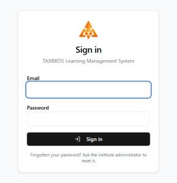
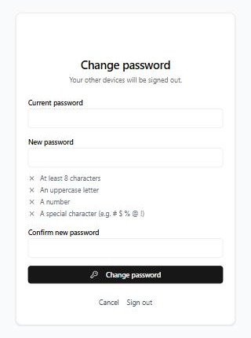
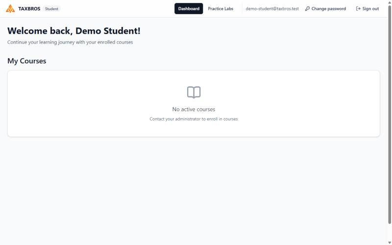
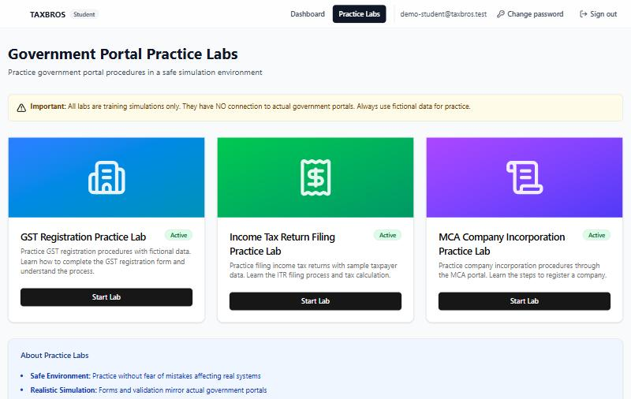
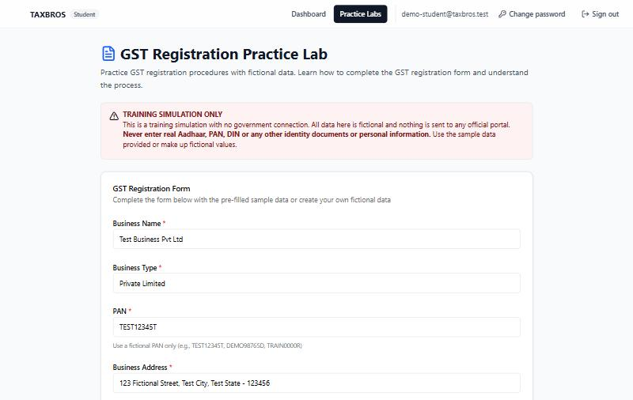
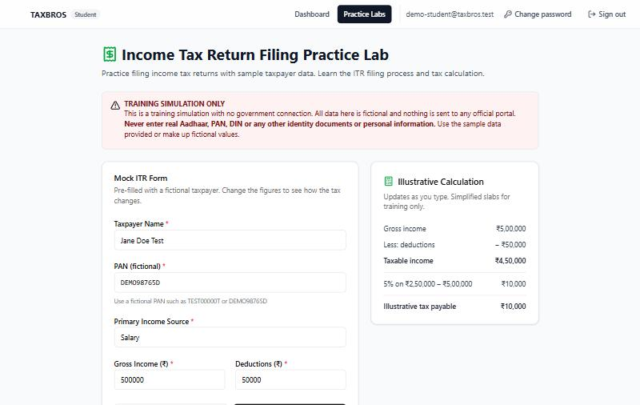

# TAXBROS LMS: Student manual

This manual explains how to sign in, follow your courses, take quizzes and practise in the government
portal labs.

## 1. Signing in

1. Open the TAXBROS LMS address in Chrome or Edge, or open the TAXBROS app on your Android phone.
2. Enter the email and temporary password from the institute and choose **Sign in**.
3. Set your own password: at least 8 characters with an uppercase letter, a number and a special
   character (for example `#`, `$`, `@`).

Forgotten your password? Ask the institute office to reset it. After 5 wrong passwords in a row your
account is locked for 15 minutes.

### Install it like an app (optional)

- **Chrome or Edge on a computer:** open the site and choose the install icon in the address bar.
- **Chrome on Android:** open the menu (three dots) and choose **Add to Home screen** or **Install app**.
- Or install the TAXBROS Android app if the institute gives you the APK file.

## 2. Your dashboard

The dashboard lists the courses you are enrolled in with your progress, the quizzes you can take, and
your completed courses. The institute enrols you in courses; ask them if a course is missing.

## 3. Watching lessons

1. Open a course from your dashboard, then a lesson.
2. Watch the video. Your place is saved as you go, so next time the video continues where you stopped.
3. A lesson is marked **Completed** when you have watched 90% of it, or when you choose
   **Mark as Complete**.
4. Your course progress is the share of published lessons you have completed.

## 4. Quizzes

1. Open a quiz from your dashboard or course. You'll see the total marks, pass mark, number of questions
   and any time limit.
2. Answer every question, then choose **Submit Quiz** and confirm.
3. If the quiz has a time limit, the clock starts when you open it and keeps running if you reload the
   page. It turns red in the last minute. When it reaches zero your answers are submitted automatically,
   and any question you didn't answer scores 0.
4. Your result shows your score and whether you passed. **Answer Review** shows your answer and the
   correct answer for each question.
5. You can take a quiz again if attempts are left. All your attempts are kept.

## 5. Practice labs

The labs let you practise government portal tasks safely. **They are simulations only: nothing is sent
to any government portal.** Never enter a real Aadhaar, PAN, DIN or any personal information; use the
sample data or make up fictional values.

### GST registration lab

Fill in the GST registration form (business name and type, PAN, address, contact details) using the
sample data, then submit. Mistakes are pointed out field by field so you can correct them.

### ITR filing lab

Enter a fictional taxpayer's income and deductions. The **Illustrative Calculation** updates as you type
to show taxable income and tax under simplified slabs. It is for training only.

### MCA company incorporation lab

Work through the company incorporation form (company name, type, directors, capital, registered office)
with fictional details and submit to see what was right and what needs fixing.

Each submission is saved, so you can see your earlier attempts.

## 6. Good practice

- Keep your password to yourself and sign out on shared computers.
- Use only fictional data in the labs.
- Watch lessons fully before taking the matching quiz.
